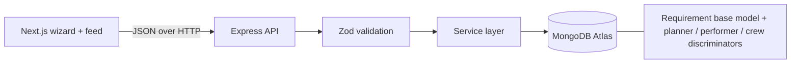

# Event Marketplace: Requirement Posting Flow

A full-stack flow where a user posts an event requirement through a 4-step wizard. The data is saved to MongoDB and categorised as **Event Planner**, **Performer** or **Crew**. A live feed shows the saved requirements with category filters.

- **Live frontend:** https://event-marketplace-chi.vercel.app
- **Live API health check:** https://event-marketplace-3.onrender.com/api/health
- **Stack:** Next.js 14 (App Router, TypeScript, Tailwind), Node.js + Express (TypeScript), MongoDB + Mongoose, Zod, Zustand, Jest

> The API runs on a free Render instance, so the first request after a period of inactivity can take up to a minute.

## Features

| Step | What it does |
|---|---|
| 1. Event basics | Event name, event type, single date or date range, location, optional venue, category (Planner / Performer / Crew) |
| 2 and 3. Category fields | Fields change with the category chosen in step 1 (see below) |
| 4. Review and submit | Read-only summary with Edit links, loading state, double-submit protection, success screen with a reference ID |

Category-specific fields:

- **Planner:** services (multi-select), guest count, budget min/max, experience level, languages, notes
- **Performer:** performance type, genre, duration, fee min/max, equipment provided, special requirements
- **Crew:** role, headcount, shift hours, pay rate and unit (per hour / per day), experience level, notes

Also included: a live feed with category tabs, search and pagination, a delete option on each card, and a Dev Console drawer that logs every API call (method, status, latency, request and response bodies).

## Architecture



Backend layers: routes -> controllers -> services -> models, with validators and a central error handler. Every response has the shape `{ success, data, error: { message, fields } }`.

## Data model

One `requirements` collection. A Mongoose **discriminator** on `category` stores the shared fields (eventName, eventType, dates, location, venue, status) plus the category-specific fields. Each document is therefore clearly categorised as `planner`, `performer` or `crew`, and `GET /api/requirements?category=crew` is a plain filter on that key.

## API

| Method | Route | Description |
|---|---|---|
| POST | `/api/requirements` | Validate (Zod discriminated union) and save. Returns 201, or 400 with `error.fields` |
| GET | `/api/requirements?category=&q=&page=&limit=` | List with category filter, text search and pagination |
| GET | `/api/requirements/:id` | One requirement (400 for an invalid id, 404 if missing) |
| DELETE | `/api/requirements/:id` | Delete one requirement |
| GET | `/api/health` | Health check |

Example request:

```json
POST /api/requirements
{
  "category": "crew",
  "eventName": "Global Tech Summit 2026",
  "eventType": "Corporate",
  "dateMode": "range",
  "startDate": "2026-11-19",
  "endDate": "2026-11-21",
  "location": "Bengaluru, Karnataka",
  "role": "Sound",
  "headcount": 6,
  "shiftHours": 10,
  "payRate": 250,
  "payUnit": "hour",
  "experienceLevel": "Expert"
}
```

Example validation error (400):

```json
{ "success": false, "error": { "message": "Validation failed", "fields": { "endDate": "End date can't be before start date" } } }
```

## Running locally

Prerequisites: Node 18+ and a MongoDB Atlas connection string (or local MongoDB).

```bash
# backend
cd backend
cp .env.example .env        # then fill in MONGODB_URI
npm install
npm run seed                # optional sample data (2 per category)
npm run dev                 # http://localhost:5000

# frontend (second terminal)
cd frontend
cp .env.example .env.local
npm install
npm run dev                 # http://localhost:3000
```

Environment variables:

- `backend/.env`: `PORT`, `MONGODB_URI`, `CORS_ORIGIN` (comma-separated list of allowed frontend origins)
- `frontend/.env.local`: `NEXT_PUBLIC_API_URL`

## Deployment

- **Frontend:** Vercel, with `NEXT_PUBLIC_API_URL` pointing at the Render API.
- **Backend:** Render, with `MONGODB_URI` and `CORS_ORIGIN` set as environment variables.
- **Database:** MongoDB Atlas.

## Tests

```bash
cd backend && npm test      # Jest + Supertest + mongodb-memory-server
cd frontend && npm test     # Jest + React Testing Library
```

Backend tests cover valid POST for each category, validation failures (empty body, missing services, end before start, past date, budget min greater than max), unknown-key stripping, filtering, search, pagination, invalid and unknown ids, and delete. Frontend tests cover step validation, category-specific fields, and the category-switch notice.

## Design decisions and assumptions

- **Validation on both sides.** The same rules run in the browser (instant feedback) and on the server (the source of truth). Server errors are mapped onto the right wizard step and field.
- **Category switch safeguard.** Changing category after entering details clears the category-specific data and shows a notice, so stale fields never reach the API.
- **Wizard state** lives in a Zustand store persisted to `sessionStorage`, so a refresh doesn't lose progress.
- **Dates** are `YYYY-MM-DD` strings, stored as UTC dates. The server allows one day of tolerance so timezone differences don't reject "today".
- **Assumption:** the brief doesn't specify the category fields, so I chose realistic ones for each category.

## Edge cases handled

End date before start date, past dates, optional venue left blank, whitespace-only strings, budget or fee min greater than max, negative or non-numeric numbers, category switch mid-flow, double submit, network failure, server validation errors, invalid ObjectId, empty list, loading skeletons.

## Limitations and future improvements

- No authentication: anyone can post or delete. Next step is user accounts with owner-only edit and delete.
- Search uses a regex filter, which would not scale. A MongoDB text index would be the next step.
- No file uploads (venue photos, rider documents).
- No end-to-end tests (Playwright) and no CI pipeline yet.
- Sample data comes from `npm run seed`, not from real users.